# CS6650 HW5: Product API

A Gin server implementing the Product endpoints from `api.yaml`, deployed to ECS Fargate with Terraform, load tested with Locust, and monitored with Prometheus/Grafana.

## Repo layout

- `src/` - server code (`product-service.go`), tests, and the Dockerfile
- `terraform/` - infrastructure (ECR, ECS, security group, CloudWatch logs)
- `locust/` - load tests
- `observability/` - local Prometheus + Grafana setup
- `screenshots/` - screenshots referenced below

## The API

| Endpoint | Responses |
|---|---|
| `GET /products/{productId}` | 200, 404, 500 |
| `POST /products/{productId}/details` | 204, 400, 404, 500 |

Products are stored in a `map[int32]Product` protected by a `sync.RWMutex`. The spec has no endpoint to create products, and POST returns 404 for unknown products, so the server seeds products 1-1000 on startup and POST updates an existing one.

POST returns 400 for a bad path ID, malformed JSON, missing fields, wrong types, values that break the schema constraints, or a body `product_id` that doesn't match the path. GET only lists 200/404/500 in the spec, so an invalid ID there returns 404.

To trigger a 500 on purpose, start the server with `ENABLE_FAULT_INJECTION=true` and send the header `X-Fault-Inject: 500`. This is off by default.

## Running locally

```bash
cd src
go run .
go test ./...

# or with Docker (from src/)
docker build -t product-service .
docker run --rm -p 8080:8080 -e ENABLE_FAULT_INJECTION=true product-service
```

### Example requests

```bash
# 200
curl -i http://localhost:8080/products/1

# 404
curl -i http://localhost:8080/products/99999

# 500
curl -i -H "X-Fault-Inject: 500" http://localhost:8080/products/1

# 204
curl -i -X POST http://localhost:8080/products/1/details -H "Content-Type: application/json" -d '{"product_id":1,"sku":"ABC-123-XYZ","manufacturer":"Acme Corporation","category_id":456,"weight":1250,"some_other_id":789}'

# 400 (missing fields)
curl -i -X POST http://localhost:8080/products/1/details -H "Content-Type: application/json" -d '{"product_id":1}'

# 404
curl -i -X POST http://localhost:8080/products/99999/details -H "Content-Type: application/json" -d '{"product_id":99999,"sku":"ABC-123-XYZ","manufacturer":"Acme Corporation","category_id":456,"weight":1250,"some_other_id":789}'

# 500
curl -i -X POST http://localhost:8080/products/1/details -H "Content-Type: application/json" -H "X-Fault-Inject: 500" -d '{"product_id":1,"sku":"ABC-123-XYZ","manufacturer":"Acme Corporation","category_id":456,"weight":1250,"some_other_id":789}'
```

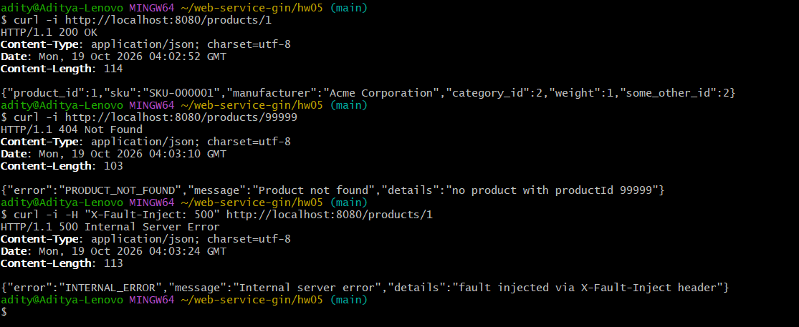
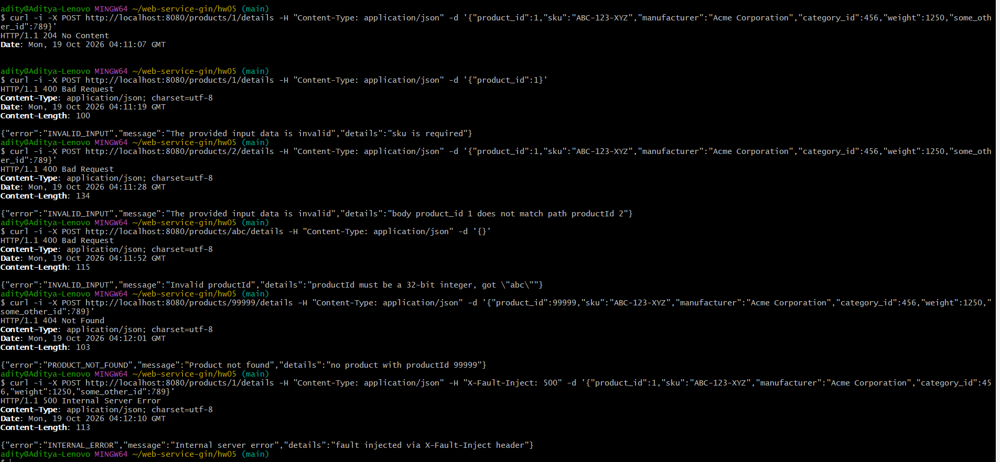

## Deploying to AWS

You need Terraform, the AWS CLI, Docker running, and an AWS account with a `LabRole` IAM role (Learner Lab has one).

```bash
# paste your Learner Lab credentials into ~/.aws/credentials, or:
aws configure
aws configure set aws_session_token <TOKEN>

git clone https://github.com/adikejre/CS6650_2b_demo.git
cd CS6650_2b_demo/terraform
terraform init
terraform apply -auto-approve
```

Terraform builds the image, pushes it to ECR, and starts the ECS service. Once the task is running (about a minute), get its public IP with the command below, run from `terraform/` in bash:

```bash
aws ec2 describe-network-interfaces --network-interface-ids $(aws ecs describe-tasks --cluster $(terraform output -raw ecs_cluster_name) --tasks $(aws ecs list-tasks --cluster $(terraform output -raw ecs_cluster_name) --service-name $(terraform output -raw ecs_service_name) --query 'taskArns[0]' --output text) --query "tasks[0].attachments[0].details[?name=='networkInterfaceId'].value" --output text) --query 'NetworkInterfaces[0].Association.PublicIp' --output text
```

Then call it with `curl http://<IP>:8080/products/1`. Tear it down with `terraform destroy -auto-approve`.

### Changes from the starter repo

- Replaced the albums server with the product service (still on port 8080).
- Renamed the service to `product-api` and the ECR repo to `product-service`.
- The Docker provider's built-in build failed with Docker Engine 29 (`failed to read dockerfile: unexpected EOF`), so Terraform now runs `docker build` through a `local-exec` and only uses the provider to push.
- The image is rebuilt whenever a file in `src/` changes, and ECS references it by digest so a new push actually triggers a redeploy.
- Added `force_delete` on the ECR repo so `terraform destroy` works when it still has images.

## Load testing

The Locust mix is roughly 85% GET for existing products, 5% GET for missing ones (expected 404), and 10% POST, since a store gets far more reads than writes. `ProductHttpUser` and `ProductFastHttpUser` run the same tasks, so the only difference is the HTTP client. All runs used 4 workers on my laptop against one Fargate task (0.25 vCPU) in us-west-2.

```bash
cd locust
# PowerShell: set these with $env:NAME="value" first
TARGET_HOST=http://<IP>:8080 USER_CLASS=ProductFastHttpUser docker compose up --scale worker=4
# stress test: WAIT=none LOCUST_FILE=stress.py STEP_USERS=500 MAX_USERS=5000
```

| Run | Client | Users | Wait | RPS | p50 | p95 | Failures |
|---|---|---|---|---|---|---|---|
| A | HttpUser | 100 | 0.1-0.5s | 256 | 88 ms | 110 ms | 0% |
| B | FastHttpUser | 100 | 0.1-0.5s | 255 | 88 ms | 100 ms | 0% |
| C | HttpUser | 200 | none | 1,829 | 97 ms | 120 ms | 0% |
| D | FastHttpUser | 200 | none | 2,003 | 91 ms | 110 ms | 0% |
| E (stress) | FastHttpUser | 500 to 5,000 | none | ~3,600 max | 670 ms | 1,300 ms | 0% |

### Where it broke

In the stress test, throughput topped out at about 3,600 RPS by the first step (500 users) and stayed flat all the way to 4,500 users. Adding users after that only increased latency, with the median going from about 120 ms to about 1.1 s. There were no failed requests; they just queued. ECS CPU was at 100% while the Locust workers sat around 50%, so the bottleneck was the 0.25 vCPU task, not my laptop. An earlier, slower ramp showed throughput still growing linearly at 350 users, so the limit is somewhere between 350 and 500 users.

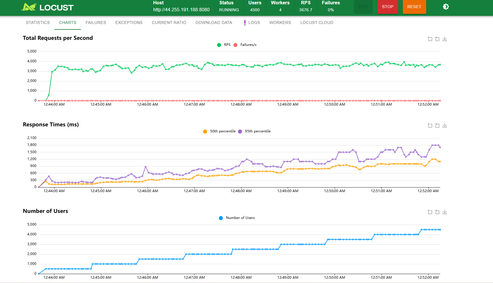
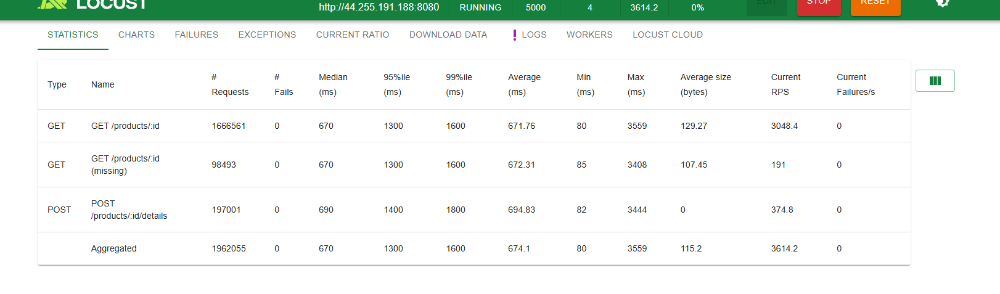
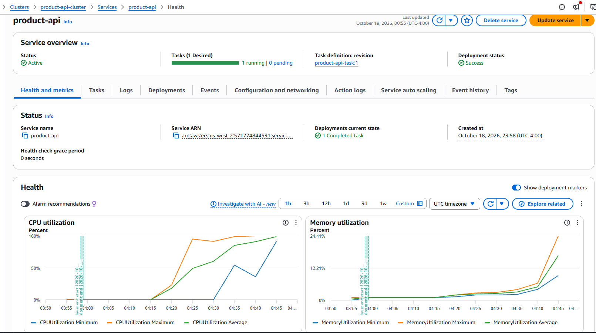
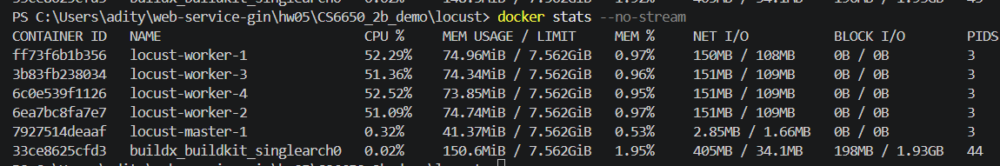

### HttpUser vs FastHttpUser

With think time (A vs B) there was no difference. The users' wait time sets the pace (100 users / ~0.39 s per cycle ≈ 256 RPS), so the client doesn't matter.

With no wait (C vs D), FastHttpUser got about 10% more throughput and a slightly lower median, while using about a third of the CPU (around 20% per worker vs 60%). HttpUser is built on python-requests, which does a lot of pure-Python work per request. FastHttpUser uses geventhttpclient, which has a C parser and much less overhead. The gap was small here because network latency (~90 ms) dominates and the workers weren't maxed out. It would grow with fewer workers or more users per worker.

<details><summary>Screenshots for runs A-D</summary>

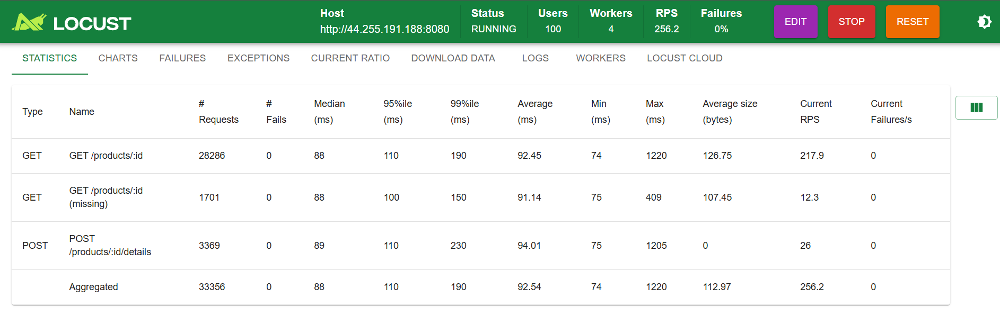
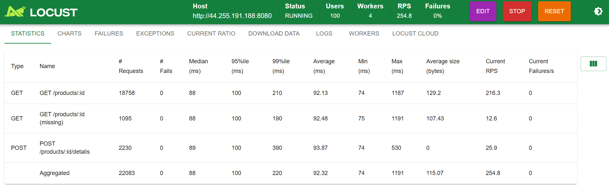
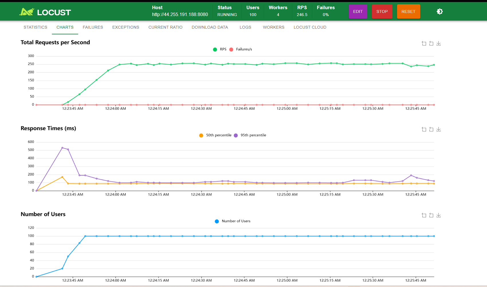
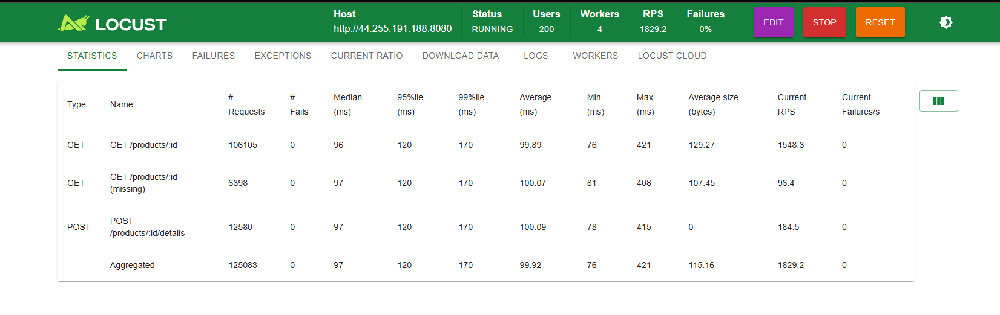
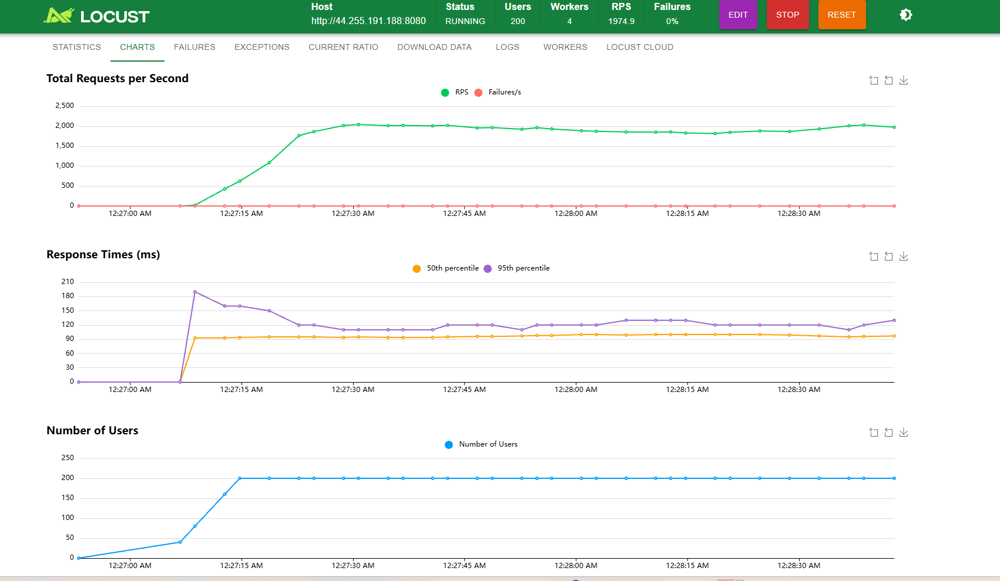
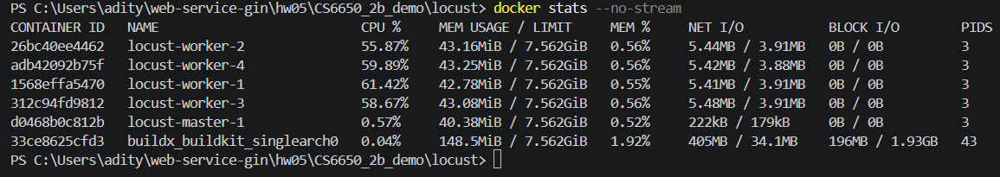
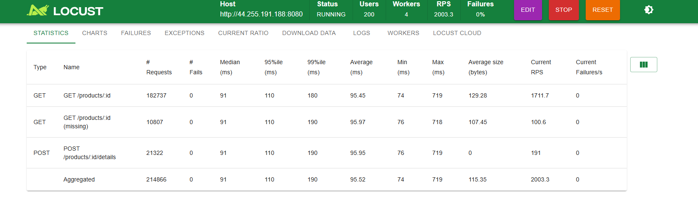
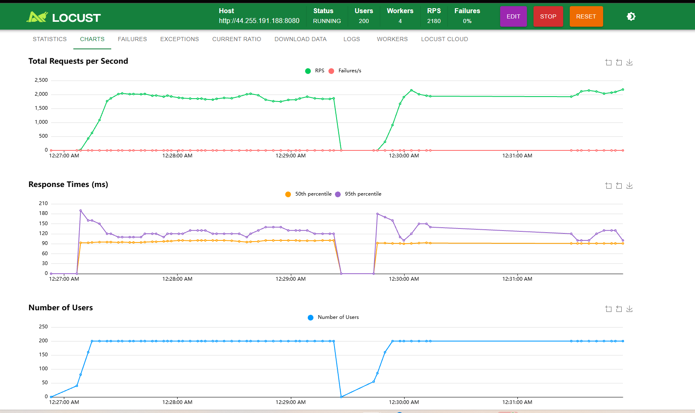
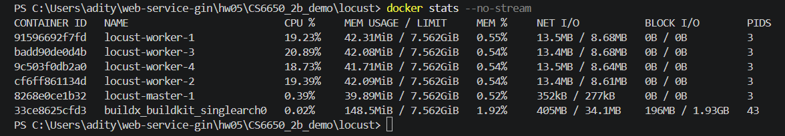

</details>

### Tradeoffs

Reads are the most common operation, which is why I used a map (O(1) lookups by ID) with an RWMutex, so GETs can run in parallel and only POSTs take the exclusive lock. If writes became frequent, that single lock would become a point of contention and I'd look at sharding the map. Since the data is in memory, it's lost on restart and isn't shared between tasks, so scaling past one task would need an external database.

## Observability

The server exposes `/metrics` with a request counter, an error counter (non-2xx), and a latency histogram, all labeled by method, route, and status. It also logs one JSON line per request.

```bash
cd observability
docker compose up --build -d
# Grafana at http://localhost:3000, dashboard "Product API - RED"
```

The local app is capped at 0.25 CPU to match Fargate. For the loaded run I used 200 FastHttpUsers with normal think time.

Idle, before any requests (the request metrics don't exist yet, so only CPU and goroutines show up):

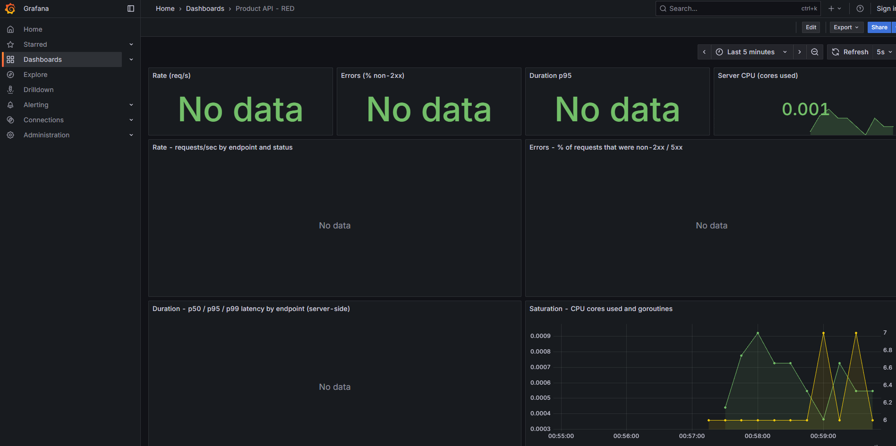

Under load, at about 648 req/s. Errors are around 5%, all from the intentional 404 requests. Server-side p95 is about 96 µs and CPU is about 0.19 cores.

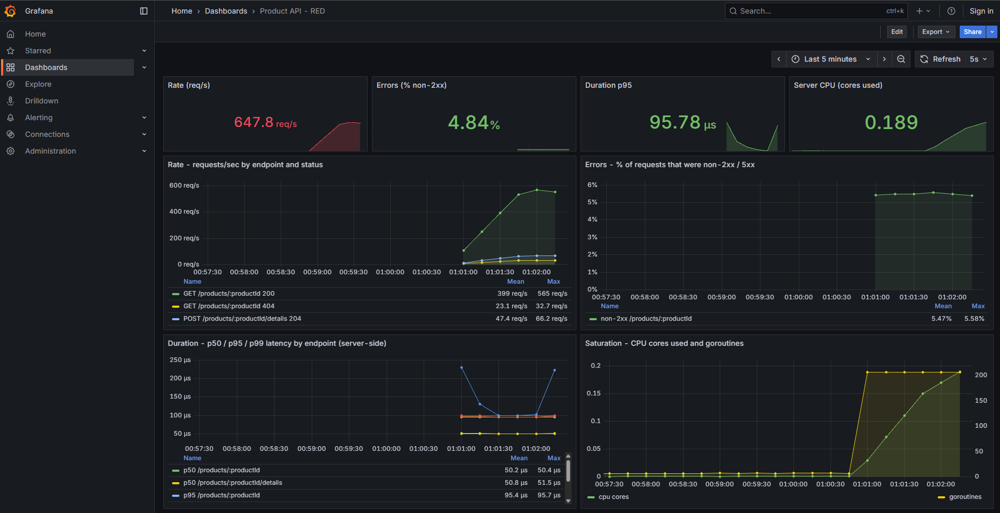

The server-side latency is around 100 µs while Locust measured about 90 ms against AWS, so almost all of the latency users see is network.

Log excerpt from the same run (full file in `screenshots/request-logs.txt`):

```json
{"time":"2026-10-19T05:03:14.612783159Z","level":"INFO","msg":"request","method":"GET","endpoint":"/products/:productId","path":"/products/803","status":200,"duration_ms":0.012,"client_ip":"172.19.0.1"}
{"time":"2026-10-19T05:03:14.612902065Z","level":"INFO","msg":"request","method":"POST","endpoint":"/products/:productId/details","path":"/products/508/details","status":204,"duration_ms":0.017,"client_ip":"172.19.0.1"}
{"time":"2026-10-19T05:03:14.616559818Z","level":"INFO","msg":"request","method":"GET","endpoint":"/products/:productId","path":"/products/1319979193","status":404,"duration_ms":0.019,"client_ip":"172.19.0.1"}
```

I'd use the dashboard to see what's happening right now, like whether latency or errors are going up during a deploy or load test. I'd use the logs afterwards to dig into specific requests, like exactly which paths failed and when, especially if nobody was watching the dashboard at the time.
